# Agent Atlas

Learn **A2A** (Agent2Agent, v1.0) and **MCP** (Model Context Protocol) by watching them. Twenty small Go
agents and ten MCP servers sit at real places on a world map. Five orchestrators delegate work to the agents
over A2A; the agents use tools, data and prompts from the MCP servers; every call goes through
**[agentgateway](https://agentgateway.dev)**. A browser UI replays the real protocol traffic slowly enough
for a person to follow: animated messages, the JSON-RPC payloads, the task state machine, the gateway's
own log, and a debugger-style replay with pause, single step and scrubber.

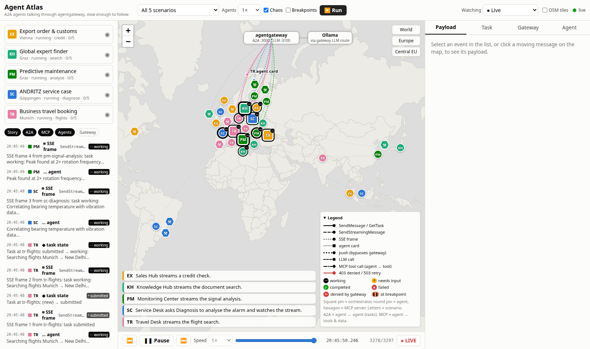

The map is didactic: A2A itself knows nothing about geography. What the map shows is the point of A2A,
delegation across network and trust boundaries, with a gateway in between. Everything on screen comes from
real protocol events, not from a simulation.

## What you see

| On the map | What it means |
|---|---|
| Square pin | An orchestrator (an A2A client). Letters = scenario. |
| Round pin | A worker agent (an A2A server). The badge shows its task state. |
| Box at the top | agentgateway. Every A2A call and every LLM call goes up into it and back down. |
| Solid line | `SendMessage` / `GetTask` |
| Dashed line, then small dots | `SendStreamingMessage` and its Server-Sent Events frames |
| Square dot, round trip | Agent card discovery (`/.well-known/agent-card.json`) |
| Dotted line that skips the gateway | Push notification to the orchestrator's webhook |
| Hexagon | An MCP server (tools, resources, prompts) |
| Dash-dot line, diamond head | MCP tool call or resource read (agent → gateway → MCP server); small dots are progress notifications |
| Red line with ✕ | The gateway refused the call (A2A 403, MCP write tool), or chaos made the agent answer 503 and the gateway retried |

**A2A vs MCP in one sentence:** A2A is agent ↔ agent (delegating a task with a lifecycle), MCP is
agent → tool (calling a function, reading data, fetching a prompt).

Every scenario uses the same five protocol features, one per agent:

| Feature | How it shows up | Gateway policy on that route |
|---|---|---|
| Discovery | The orchestrator only knows the gateway. It reads each agent's card; the gateway rewrote the card's URL to itself. | `a2a: {}` on every route |
| Streaming | `SendStreamingMessage`: the agent streams `working` status updates and artifacts. This agent's answer comes from a local LLM. | `retry` on 503 (switch on **Chaos** to see it) |
| Multi-turn | The agent asks a question (`input-required`); the orchestrator answers in the same task. | none |
| Long task + push | `returnImmediately`, push notifications to a webhook, then `GetTask` for the result. | `delay` of 2 s |
| Restricted | A CEL authorization policy: only the own orchestrator, never a `restricted-*` skill. | `authorization` |

Every scenario also has two MCP servers behind one multiplexed gateway route `/mcp/<code>`:

| MCP feature | How it shows up | Gateway policy |
|---|---|---|
| Tools chosen by the model | The LLM agent fetches its system prompt over MCP (`prompts/get`), lists the tools (`tools/list`, already filtered by the gateway) and lets qwen3 call them as functions; the results go back to the model. | multiplexing prefixes names per server |
| Resources | The multi-turn agent reads a manual or a rule document (`resources/read`). | |
| Progress | The long-task agent calls a slow tool; its progress notifications stream through the gateway and become A2A status updates. | |
| Tool authorization | The restricted agent tries a write tool. The gateway hides write tools from `tools/list` and refuses the call (400 "Unknown tool"); it never reaches the server. | `mcpAuthorization` (CEL on `mcp.tool.name`), plus HTTP `authorization`: only the scenario's own agents |

The five scenarios:

| Code | Scenario | Orchestrator | MCP servers |
|---|---|---|---|
| SC | ANDRITZ service case: bearing alarm on a turbine in Brazil | Service Desk, Göppingen | Plant Historian (Curitiba), ERP & Spare Parts (São Paulo) |
| EX | Export order & customs: a refiner for Canada | Sales Hub, Vienna | Tariff & Sanctions DB (Luxembourg), Order Management (Montreal) |
| PM | Predictive maintenance: vibration anomaly at a Finnish pulp mill | Monitoring Center, Graz | Mill Historian (Jyväskylä), Maintenance System (Oulu) |
| TR | Business travel booking: Munich to New Delhi | Travel Desk, Munich | Flight Inventory (Madrid), HR & Travel Policy (Hamburg) |
| KH | Global expert finder: a question from Pohang | Knowledge Hub, Graz | Document Store (Dublin), Translation Memory (Seoul) |

Scenarios are YAML files in `scenarios/`. `make gen` turns them into the compose services and the gateway
config.

## Quick start

You need Docker with Compose v2, `make`, `curl` and `jq`. For the tests also Go 1.26 and Node 22.

```bash
cp .env.example .env
make up            # ~40 containers, waits until healthy
make ollama-install  # optional: local LLM for the five LLM agents (no root, ~3 GB download)
```

Open **http://localhost:3000**, pick a scenario (or "All 5 scenarios") and press **Run**.

- **Agents 0.5×–4×** makes the agents' scripted work slower or faster.
- **Chaos** makes the streaming agent fail the first attempt; the gateway's retry policy recovers.
- **Breakpoints** makes the orchestrators wait before every delegation until you press Continue.
- **Pause** (or space) switches to replay. Step with ← / →, scrub, change the replay speed. **LIVE** (or L) returns.
- Click a moving message or an event for its payload, a pin for the agent and its live card, the gateway box for its log.
- **Watching** switches between live, recorded sessions (`data/sessions/*.jsonl`), a JSONL file, and the bundled sample.

Without any backend: `make web-fixtures` serves the UI on http://localhost:3001 replaying
`web/public/samples/demo.jsonl`.

| Service | URL |
|---|---|
| Agent Atlas UI | http://localhost:3000 |
| Visualizer API (events, runs, gates) | http://localhost:8095 |
| agentgateway: A2A / LLM / admin UI | http://localhost:8000 · :8100 · http://localhost:15000/ui |
| Jaeger (one trace per run) | http://localhost:16686 |

## Architecture

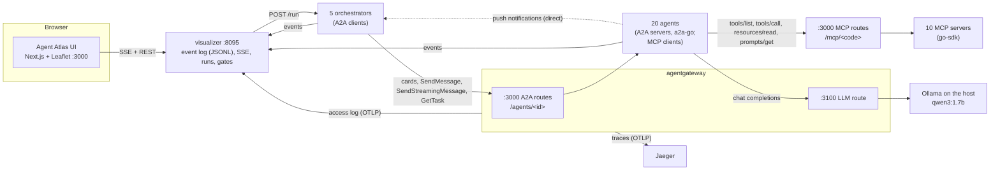

The visualizer merges three views: what the orchestrator saw on the wire (an `http.RoundTripper` records
every request, response and SSE frame), what the agents did behind the gateway, and what the gateway logged
(it parses A2A: method, task state, context id, retries). The contract is in [docs/events.md](docs/events.md).

## Commands

```bash
make help              # all targets
make run SCENARIO=all SPEED=1 CHAOS=true BREAKPOINTS=false
make tail-events       # the live event stream, one line per event
make card ID=sc-logistics   # an agent card through the gateway
make gate-release      # continue all breakpoints
make test lint web-test     # Go tests, lint, web tests
make e2e               # Playwright against the running stack
make screenshots       # regenerate docs/screenshots
make record-sample     # re-record the bundled sample
```

## Screenshots

| | |
|---|---|
| 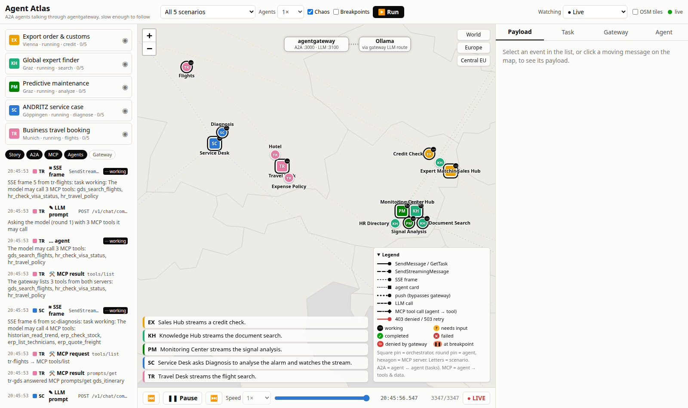 Central Europe: four scenarios share Graz, Vienna, Munich and Göppingen. | 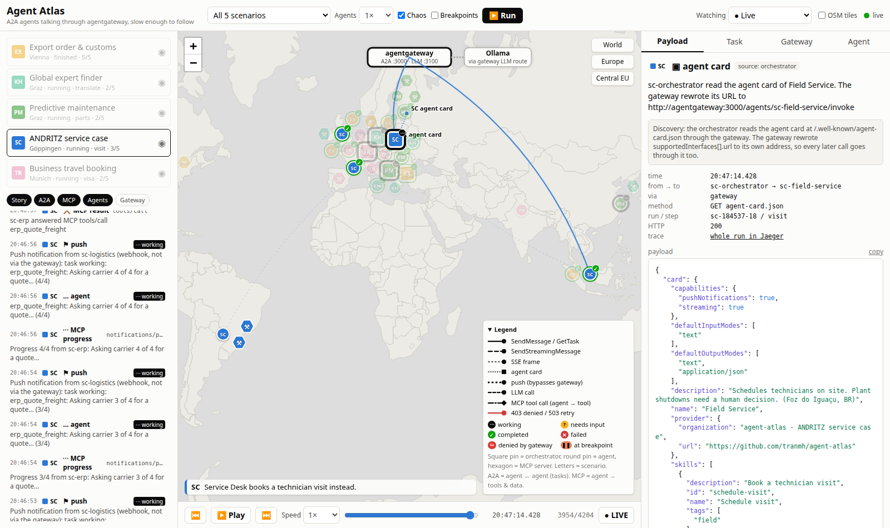 Discovery: the card's URL was rewritten by the gateway. |
| 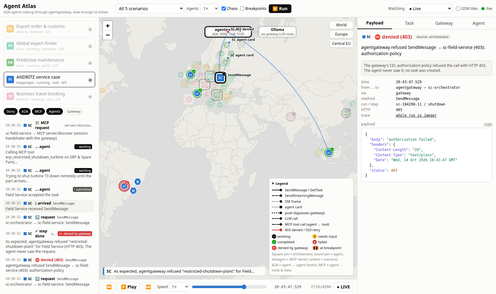 The gateway refuses a restricted skill (403); the agent never sees it. | 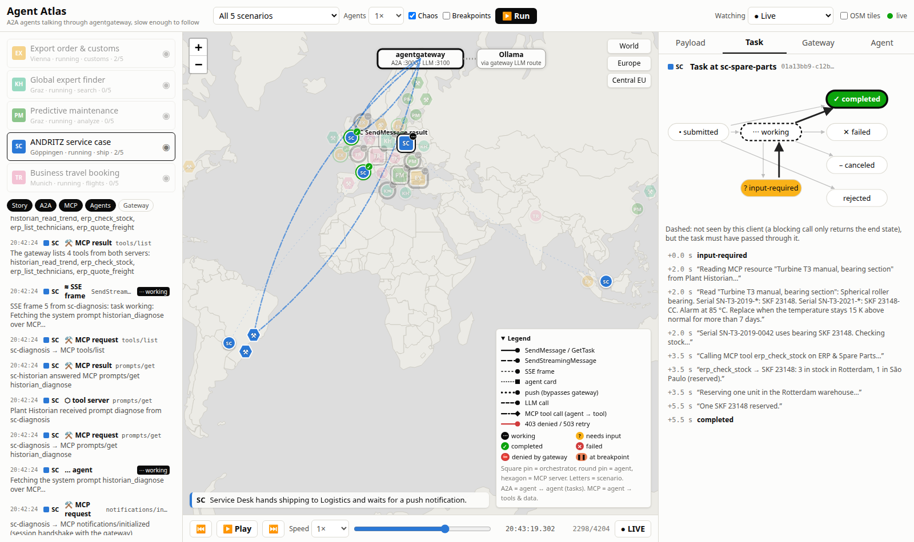 A multi-turn task: input-required, then completed. |
| 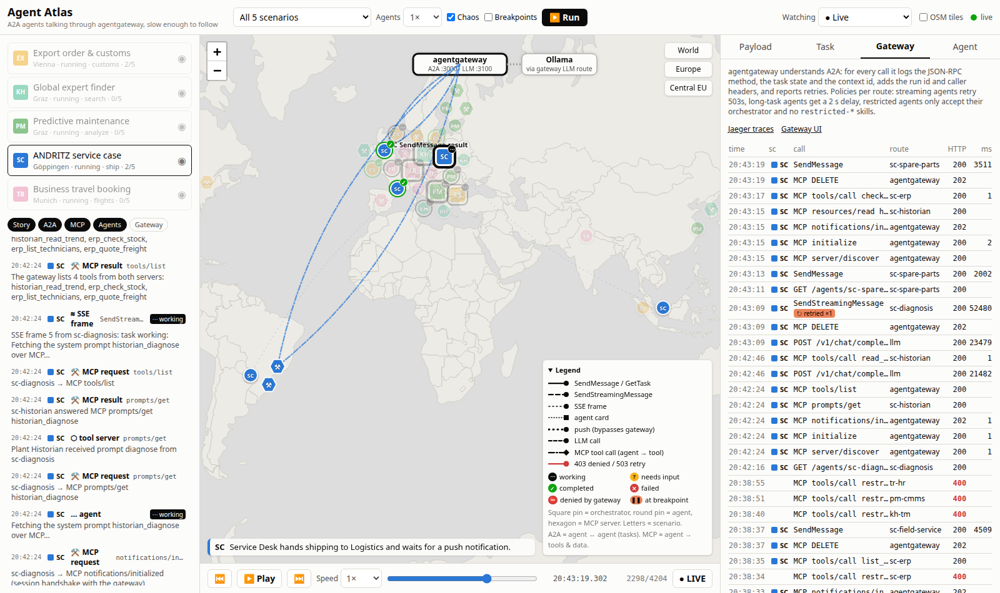 The gateway's own view, including the retry. | 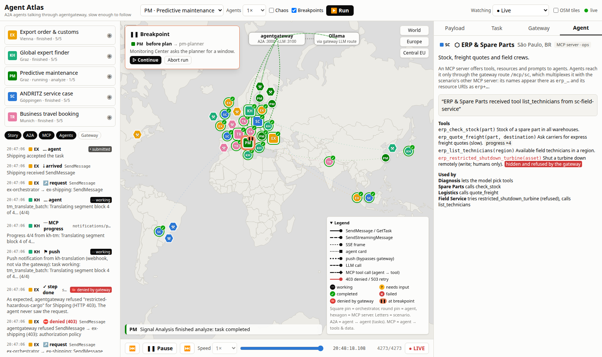 Breakpoint mode: the orchestrator waits for you. |
| 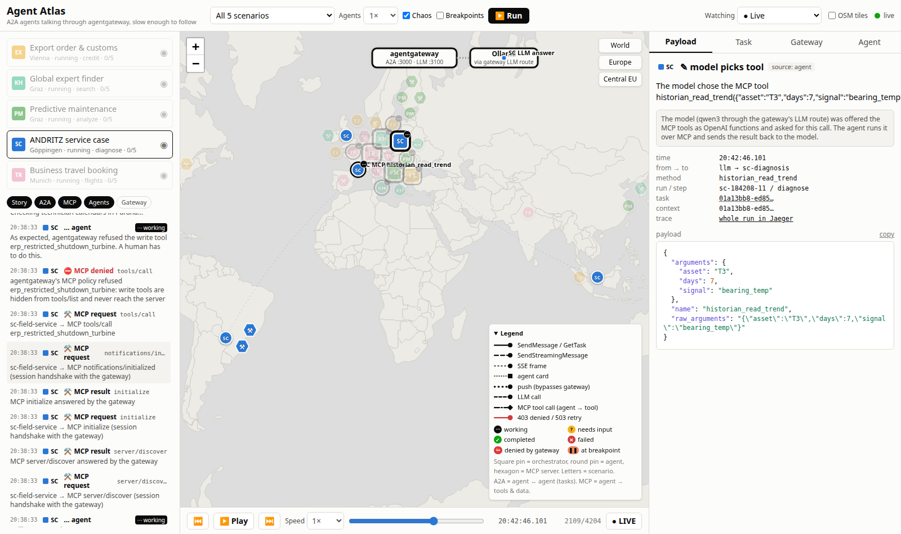 The model picked an MCP tool; the agent runs it through the gateway. | 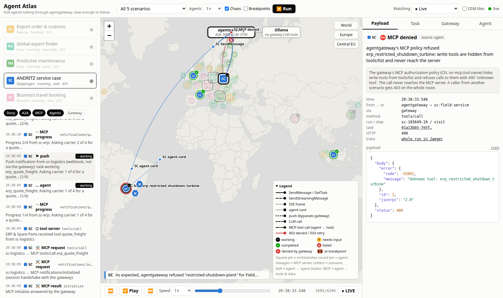 The gateway's MCP policy refuses a write tool. |
| 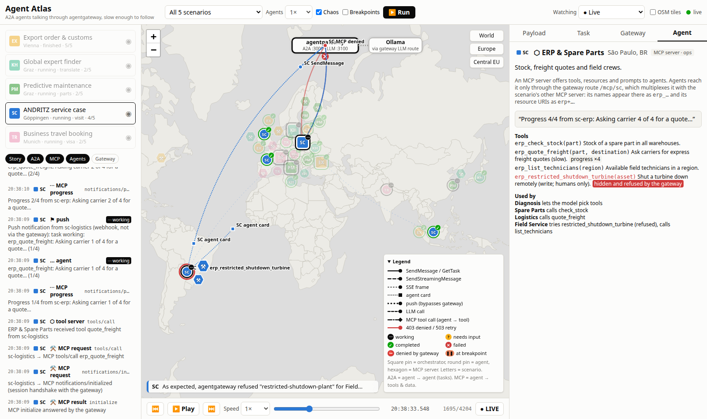 An MCP server: prefixed tools, the hidden write tool, who uses it. | |

## More

- [docs/plans/2026-10-14-master-plan.md](docs/plans/2026-10-14-master-plan.md) and [PROGRESS.md](docs/plans/PROGRESS.md): plan, decisions, deviations.
- [docs/events.md](docs/events.md): the event log contract.
- [docs/ollama.md](docs/ollama.md): the local LLM setup and CPU-vs-iGPU measurements.
- [docs/plans/2026-10-14-mcp-plan.md](docs/plans/2026-10-14-mcp-plan.md): the MCP extension.
- Built on [a2a-go](https://github.com/a2aproject/a2a-go) v2.6.0 (A2A v1.0), the [MCP Go SDK](https://github.com/modelcontextprotocol/go-sdk) v1.8.0 and agentgateway v1.6.0.
